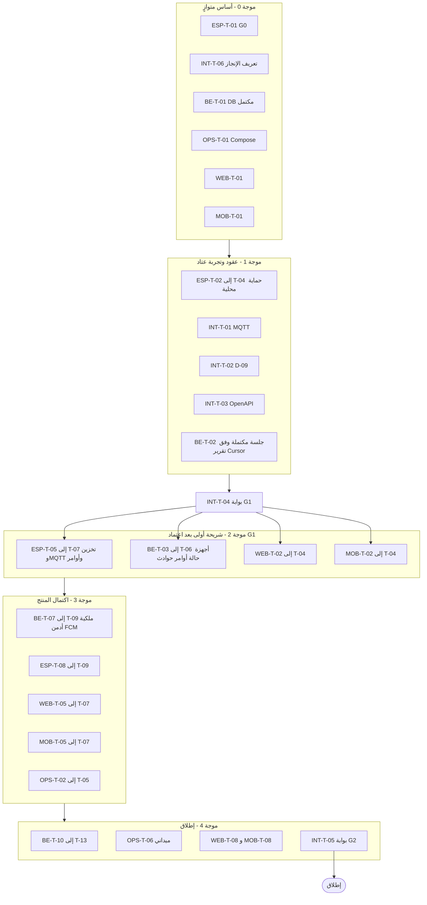

# تسلسل تنفيذ المهام عبر المشاريع

ملف عام لترتيب العمل بين المجلدات الستة. تفاصيل كل مهمة في ملف `*-development-tasks.md` داخل مجلدها. إغلاق أي مهمة وفق `integration/integration-definition-of-done.md`.

**ترميز المهام العابرة للمشاريع:** `BE-T-xx` و`ESP-T-xx` و`MOB-T-xx` و`WEB-T-xx` و`INT-T-xx` و`OPS-T-xx`؛ `AC-T-xx` خاص بمصفوفة القبول، دون إعادة ترقيم عناوين البطاقات داخل ملفاتها.

| اختصار | المجلد | ملف المهام |
|--------|--------|------------|
| `backend` | `security_backEnd` | `backend-development-tasks.md` |
| `esp` | `security_esp` | `esp-development-tasks.md` |
| `mobile` | `security_mobile` | `mobile-development-tasks.md` |
| `web` | `admin_web` | `web-development-tasks.md` |
| `int` | `integration` | `integration-development-tasks.md` |
| `ops` | `ops` | `ops-development-tasks.md` |

المهمة الجارية لكل مشروع: ملف `*-current.md` في نفس المجلد.

---

## بوابات لا تُتجاوز

| بوابة | المعنى | شرط المرور |
|--------|--------|------------|
| **G0** | بدء firmware إنتاج / تهيئة نهائية | `ESP-T-01` (`D-01`…`D-07`) موثّق |
| **G1** | تثبيت مسارات أوامر/حوادث إنتاجية | `INT-T-01`…`T-04` معتمدة من ESP+باك+Flutter |
| **G2** | إطلاق | مصفوفة قبول + ميداني؛ حرجة: إنذار محلي وعزل ملكية/قنوات |

---

## الموجة 0 — ابدأ فوراً (توازي واسع)

لا تنتظر اكتمال الطرف الآخر إلا حيث يُذكر.

| ترتيب | المهمة | ملاحظة |
|------:|--------|--------|
| 0.1 | `INT-T-06` | تعريف الإنجاز — مرجع لكل الإغلاقات |
| 0.2 | `ESP-T-01` | قرارات G0 / `D-01`…`D-07` |
| 0.3 | `BE-T-01` | **منجز** — المخطط والقيود |
| 0.4 | `OPS-T-01` | Compose + Mosquitto محلي (**P2**) |
| 0.5 | `WEB-T-01` و `MOB-T-01` | تأسيس المشاريع — توازي كامل |

**بعد 0.2 جزئياً (`D-01`/`D-02`):** يمكن بدء `ESP-T-02` على الطاولة دون انتظار الويب.

---

## الموجة 1 — عقود + عتاد محلي + جلسة

| ترتيب | المهمة | تعتمد على | يتوازى مع |
|------:|--------|-----------|-----------|
| 1.1 | `ESP-T-02` → `ESP-T-03` → `ESP-T-04` | `ESP-T-01` | — |
| 1.2 | `INT-T-01` مسودة MQTT | مسودة `D-04`/`D-05` من esp | `ESP-T-02…T-04` |
| 1.3 | `INT-T-02` قرار D-09 | `INT-T-01` | — |
| 1.4 | `BE-T-02` جلسة وحسابات **مكتملة وفق Cursor** | `BE-T-01` | لا انتظار لعقد MQTT/G1 |
| 1.5 | `INT-T-03` OpenAPI | استخرج Auth المنفذ في Backend T-02 أولاً ثم صِف المسارات المؤجلة | تأسيس `web`/`mobile` |
| 1.6 | `WEB-T-02` و `MOB-T-02` | `*/T-01` + مسودة OpenAPI | بعضهما |

**مخرج مطلوب قبل الموجة 2 الثقيلة:** إنذار محلي يعمل بلا شبكة (`esp` اختبارات قبول العتاد T-01/T-02 من الخطة).

---

## الموجة 2 — بوابة G1 ثم الشريحة المتكاملة الأولى (**P3**)

### 2-أ اعتماد العقد (حرج)

| ترتيب | المهمة | تعتمد على |
|------:|--------|-----------|
| 2.0 | `INT-T-04` **G1** | `INT-T-01` `T-02` `T-03` |

لا تُغلق أوامر/حوادث إنتاجية في الباك أو ESP قبل 2.0 (يجوز التطوير خلف محاكاة العقد).

### 2-ب بعد G1 — ثلاثة مسارات متوازية

**مسار الجهاز**

1. `ESP-T-05` تخزين وطابور أحداث  
2. `ESP-T-06` شبكة وMQTT  
3. `ESP-T-07` أوامر بعيدة + ACK + ملكية  

**مسار الخادم**

1. `BE-T-03` تسجيل جهاز وربط  
2. `BE-T-04` استقبال MQTT وحالة  
3. `BE-T-05` أوامر وOutbox  
4. `BE-T-06` حوادث وEVENT_PERSISTED + طلب إشعار  

**مسار الواجهات (يمكن البدء بمحاكاة ثم الربط الحقيقي)**

1. `WEB-T-03` → `WEB-T-04` قائمة وتفاصيل/أوامر  
2. `MOB-T-03` → `MOB-T-04` (**MOB-03**) كذلك  

**تعريف اكتمال الموجة 2:** أمر ARM مؤكَّد من واجهة عبر باك→MQTT→جهاز، وحادثة تُحفظ مع EVENT_PERSISTED (عامل FCM يمكن تأجيله).

---

## الموجة 3 — اكتمال الوظائف (**P4** / **P5**)

تُنفَّذ بالتوازي بعد استقرار الشريحة الأولى:

| المسار | التسلسل |
|--------|---------|
| باك | `BE-T-07` نقل ملكية → `T-08` أدمن → `T-09` عامل FCM |
| ESP | `ESP-T-08` تشخيص/Wi-Fi محلي → `ESP-T-09` استرداد/ESP-IDF/NFR-008 جهاز |
| ويب | `WEB-T-05` سجل → `T-06` أدمن → `T-07` تنبيهات |
| موبايل | `MOB-T-05` سجل → `T-06` FCM عميل → `T-07` Wi-Fi محلي (مع `ESP-T-08`) |
| تشغيل | `OPS-T-02`…`T-05` بيئات/نشر/نسخ/مراقبة (بعد أو مع استقرار staging) |

**اعتماديات متقاطعة مهمة**

- `MOB-T-06` يحتاج API رموز من `BE-T-09` (أو عقد الرموز جاهز).  
- `MOB-T-07` يحتاج مسار التهيئة من `ESP-T-08`.  
- `WEB-T-06`/`T-07` تحتاج مسارات إدارة `BE-T-02`/`T-03`/`T-07`/`T-08`.  
- `BE-T-13` (NFR-008 خادم) بعد اعتماد أرقام `D-03` من `ESP-T-01`/`T-09`.

---

## الموجة 4 — قبول وإطلاق (**P6** / **P7**)

| ترتيب | المهمة | تعتمد على |
|------:|--------|-----------|
| 4.1 | `BE-T-10` اختبارات تكامل باك | أوامر/حوادث/ملكية/FCM |
| 4.2 | `BE-T-11` جاهزية التطبيق | `ops` staging |
| 4.3 | `BE-T-12` احتفاظ تشغيلي | سياسة D-06 |
| 4.4 | `BE-T-13` NFR-008 خادم | D-03 معتمد |
| 4.5 | `WEB-T-08` و `MOB-T-08` | مسارات الواجهة المعنية |
| 4.6 | `OPS-T-06` تجربة ميدانية | شريحة متكاملة + عتاد |
| 4.7 | `INT-T-05` تحديث المصفوفة + **G2** | staging + ميداني + حرجة ناجحة |

---

## ماذا يعمل الآن؟ (لقطة سريعة)

حدّث هذا الجدول يدوياً عند تغيير `*-current.md`:

| المشروع | الملف الحالي | الحالة المقترحة الآن |
|---------|--------------|----------------------|
| `backend` | `backend-current.md` | **T-03** جزئية — `SS-P2-010`/`SS-P2-020` ✓؛ التالية `SS-P2-030` (T-01 وT-02 مكتملتان) |
| `esp` | `esp-current.md` | **T-01** قرارات G0 |
| `int` | `integration-current.md` | **T-01** مسودة MQTT (بعد/مع D-04) أو **T-06** تعريف الإنجاز فوراً |
| `ops` | `ops-current.md` | **T-01** Compose محلي |
| `web` | `web-current.md` | **T-01** تأسيس المشروع |
| `mobile` | `mobile-current.md` | **T-01** تأسيس المشروع |

---

## قواعد التوازي (مختصر)

1. **العتاد المحلي أولاً للسلامة:** `ESP-T-02…T-04` لا تنتظر Flutter.  
2. **العقد قبل الإنتاج:** G1 قبل إغلاق `BE-T-05`/`T-06` و`ESP-T-07`.  
3. **الواجهات:** تأسيس + نماذج مبكراً؛ أوامر مؤكدة بعد G1 وجهاز/محاكي ACK.  
4. **FCM:** حفظ الطلب في `BE-T-06` قبل عامل `T-09`؛ العميل في `MOB-T-06`.  
5. **التشغيل:** Compose من الموجة 0؛ staging/نسخ/ميداني بعد الشريحة الأولى.  
6. **لا إطلاق** إلا باجتياز AC-T-01…AC-T-25 كما تنص خطة التطوير §12؛ الأربعة الحرجة (01/02/10/11) تمنع الإطلاق على نحو خاص، ولا يعني ذلك إعفاء البقية.

خريطة المجلدات: `README_PLANNING.md`.  
مصفوفة القبول: `integration/integration-acceptance-matrix.md`.

**توضيح البوابات:** G0 يخص اعتماد قرارات العتاد ولا ينتظر إغلاق G1؛ تكفي مسودتا D-04/D-05 لبدء INT-T-01. يُحظر إغلاق مسارات MQTT/الأوامر/الحوادث الإنتاجية قبل اعتماد G1، وتظل G2 خاضعة لنجاح جميع سيناريوهات القبول الـ25.

**ملاحظة تاريخية:** تصف الموجات ترتيب الاعتماديات لا الوضع الجاري؛ Backend T-02 مكتملة و`SS-P2-010` داخل T-03 مغلقة 2026-11-05؛ الربط PENDING والأرشفة ما زالا مفتوحين.
